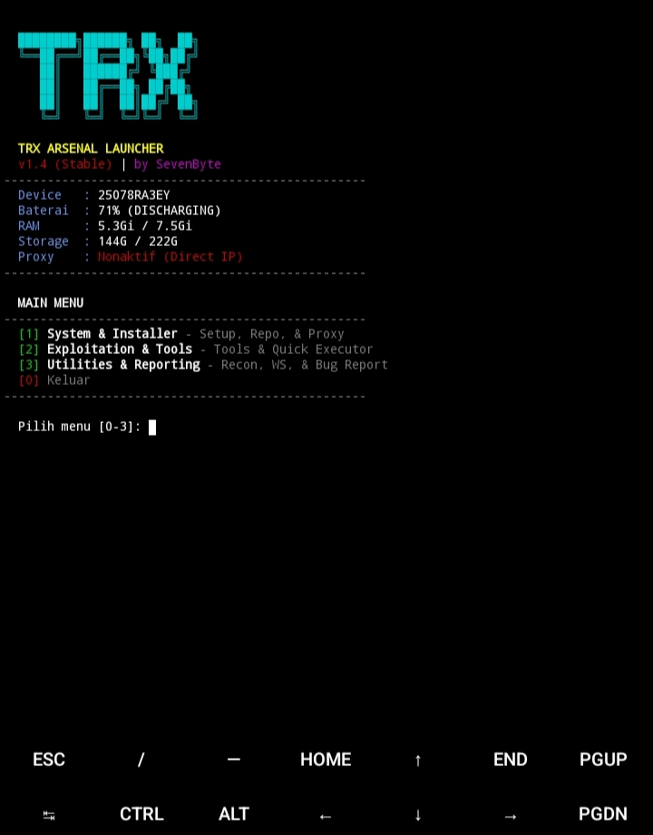

<div align="center">
  <h1>TRX Arsenal</h1>
  <p><b>Portable Web Pentesting & Bug Hunting Framework for Android (Termux)</b></p>

  [](https://f-droid.org/packages/com.termux/)
  [](https://f-droid.org/packages/com.termux.api/)
  [](https://python.org)
  []()
  [](LICENSE)
</div>

---
## 📖 Tentang Project

**TRX Arsenal** adalah *framework* pentest dan bug hunting yang dirancang khusus untuk lingkungan Android (Termux). 

Project ini lahir dari kebutuhan untuk memiliki *setup* yang **portabel, rapi, dan siap tempur** tanpa harus mengorbankan RAM atau storage HP. Semua *tools* dibungkus dalam satu Launcher interaktif (`trx.sh`) dan modul `engine/` yang otomatis. Tidak perlu PC berat, semua bisa jalan di HP.

---

## 📸 Tampilan Launcher

<div align="center">
  
  <br>
  <i>TRX Arsenal v1.8 — Clean CLI Interface (Device Info, Proxy Status, & Categorized Menu)</i>
</div>

---
## ⚡ Fitur Utama

- **🚀 One-Click Setup:** Instalasi massal tool Recon & Exploit (`sqlmap`, `nuclei`, `ffuf`, `subfinder`, dll).
- **🕵️ Auto Recon Pipeline:** Otomasi pengumpulan subdomain hingga crawling (Subfinder → Httpx → Katana).
- **🌐 Origin Discovery:** Deteksi IP asli di balik Cloudflare/WAF (CloudFail v2, CloudRecon, Origindive).
- **🛡️ Global Proxy Rotator:** Rotasi proxy otomatis untuk *bypass* rate-limit/WAF (Support Auth & Link Manager).
- **💾 SQLite Database:** Simpan hasil recon & vulnerability, bisa di-*query* lewat Terminal (Filter Severity).
- **🤖 Telegram Bot (Remote Shell):** Notifikasi *real-time* + eksekusi perintah terminal dari jarak jauh via Telegram (Terenkripsi).
- **🕵️ JS Secret Analyzer:** Cari API Key/Secret yang terekspos di file JavaScript.
- **🌍 Multi-Language UI:** Antarmuka Bahasa Indonesia & English.
- **📝 Auto-Log & Report:** Setiap scan otomatis tersimpan ke folder `reports/` (Markdown & Log).
- **📊 Web Dashboard:** UI Lokal (Flask) untuk melihat database, filter bug (Critical/High), dan cetak laporan ke PDF.
- **📱 Termux API Integration:** Info Baterai/RAM/Storage di banner & notifikasi lokal.
- **🐳 Docker Support:** Bisa dijalankan di VPS/Linux via Docker.

---
## 📋 Prasyarat (Wajib)

1. **Termux:** [Download di F-Droid](https://f-droid.org/packages/com.termux/) (Jangan Play Store).
2. **Termux:API:** [Download di F-Droid](https://f-droid.org/packages/com.termux.api/) (Untuk fitur Notifikasi & Baterai).
3. **Storage Permission:** Jalankan `termux-setup-storage` di Termux.

---

## 🚀 Instalasi Cepat

Buka Termux, lalu jalankan perintah berikut:

```
# 1. Clone Repository
git clone https://github.com/Fly3417/trx-arsenal.git
cd trx-arsenal

# 2. Beri Izin Eksekusi
chmod +x trx.sh engine/setup.sh engine/verify.sh

# 3. Jalankan Launcher & Setup
./trx.sh
# Pilih Menu [1] System & Installer -> [1] Setup Full
```

⚠️ Catatan: Proses instalasi (terutama Go & Python) memakan waktu 10–30 menit tergantung HP dan koneksi. Pastikan baterai penuh dan termux-wake-lock aktif.

---
## 🛠️ Struktur Project

```
trx-arsenal/
├── trx.sh                # Launcher Utama
├── README.md
├── Dockerfile
├── docker-compose.yml
├── engine/               # Modul "Otak" Sistem
│   ├── setup.sh, verify.sh, weapons.sh
│   ├── proxy_rotator.py, ws_scanner.py
│   ├── auto_recon.py, js_analyzer.py
│   ├── log_to_report.py, wordlist_manager.py
│   ├── nuclei_manager.py, web_dashboard.py
│   ├── db_manager.py, notify.py, config_manager.py
│   ├── crypto_utils.py, telegram_bot.py
│   └── lang/             # File bahasa (id.sh, en.sh)
├── tools/                # [IGNORED] Hasil Git Clone
├── archives/             # [IGNORED] ExploitDB
├── weapons/              # [IGNORED] Wordlist & Payload
├── dumps/                # [IGNORED] Hasil dump
├── targets/              # [IGNORED] Data recon & trx.db
└── reports/              # [IGNORED] Laporan & Log
```
---

---


## 🕹️ Panduan Menu Launcher

Jalankan `./trx.sh` untuk membuka menu interaktif. Menu utama dibagi menjadi 3 kategori besar (mendukung Bahasa Indonesia & English):

| Menu | Kategori | Deskripsi |
| :--- | :--- | :--- |
| `[1]` | **System & Installer** | Setup awal, repair file, clone repo/tool, ganti bahasa, & atur proxy/telegram. |
| `[2]` | **Exploitation & Tools** | Memilih tools yang terinstall & membuka *Quick Executor* (Command Line). |
| `[3]` | **Utilities & Reporting** | Auto Recon, WebSocket, JS Analyzer, Database, Web Dashboard, & Bug Report. |
| `[0]` | **Keluar** | Keluar dari Launcher. |

### 🔍 Sub-Menu Penting

**1. System & Installer (Menu 1)**
- **Setup & Verify:** Instalasi total (`setup.sh`) atau cek file korup (`verify.sh`).
- **Repo & Git Install:** Clone repo tool baru (otomatis deteksi dependensi) atau *Dump `.git`*.
- **Setelan & Jaringan:** Ganti bahasa UI, atur *Proxy Manager*, Refresh Device Info, atau Setup Token Telegram.

**2. Exploitation & Tools (Menu 2)**
- **Pilih Tools:** Menampilkan daftar tool aktif dan membuka *prompt* fokus (bisa pindah tool pakai `cd [tool]`).
- **Quick Executor:** Prompt interaktif `root㉿trx`. Ketik `sqlmap -u target.com` atau perintah bash biasa.

**3. Utilities & Reporting (Menu 3)**
- **Recon & Fingerprint:** Wappalyzer, Caniscrape, & WebSocket Scanner.
- **Bug Report Generator:** Membuat laporan Markdown profesional otomatis di folder `reports/`.
- **Auto Recon Pipeline:** Subfinder → Httpx → Katana (otomatis simpan hasil).
- **JS Secret Analyzer:** Cari API Key/Secret di file JavaScript.
- **Takeover Checker:** Cek Subdomain Takeover.
- **Database Query:** Query SQLite (`trx.db`) buat nyari bug *Critical*.
- **Nuclei Manager:** Update template & cek total template.
- **Web Dashboard:** Nyalain *local web server* buat liat report lewat browser.
- **Telegram Remote Shell:** Kontrol terminal dari HP/PC lain via bot.

---

## 📋 Detail Menu Lengkap

## [1] System & Installer

| Opsi | Fitur | Fungsi |
| :--- | :--- | :--- |
| `1` | Setup & Verify | `setup.sh` (install total) / `verify.sh` (repair file korup) |
| `2` | Repo & Git | Clone repo baru (auto-detect `requirements.txt`, `package.json`, `go.mod`, `composer.json`) atau Dump `.git` |
| `3` | Setelan & Jaringan | Ganti bahasa (ID/EN), Proxy Manager, Refresh device info, Set Telegram Bot |
| `0` | Kembali | — |

**Sub-menu Setelan & Jaringan:**

| Opsi | Fitur |
| :--- | :--- |
| `1` | Ganti Bahasa (ID / EN) |
| `2` | Proxy Manager (Rotator / Direct / Auth / Link Sumber) |
| `3` | Refresh Device Info (update RAM/Baterai/Storage di banner) |
| `4` | Set Telegram Bot (Token & Chat ID, terenkripsi) |

---

#### [2] Exploitation & Tools

| Opsi | Fitur | Fungsi |
| :--- | :--- | :--- |
| `1` | Daftar Tools | Pilih tool dari `tools/` & `$HOME/go/bin`, masuk prompt fokus |
| `2` | Quick Executor | Shell interaktif `root㉿trx` untuk eksekusi bebas |
| `0` | Kembali | — |

**Contoh Prompt Daftar Tools:**
```

=========================================
TOOL: sqlmap
Ketik 'cd [tool]' untuk pindah.
Ketik '0' untuk kembali.
=========================================
┌──(root㉿sqlmap)-[~]
└─$ -u "https://target.com/?id=1" --batch --dbs

```

**Perilaku Quick Executor:**

| Input | Aksi |
| :--- | :--- |
| Nama tool terinstall (`sqlmap ...`) | Dijalankan via `weapons.sh` + auto-log |
| `cd [tool]` | Masuk mode fokus tool tersebut |
| Perintah bash (`ls -la`, `curl ...`) | Dieksekusi langsung |
| `0` / `exit` (saat mode tool) | Keluar dari mode tool |
| `0` / `exit` (tanpa mode tool) | Kembali ke menu utama |

---

## [3] Utilities & Reporting

| Opsi | Fitur | Fungsi |
| :--- | :--- | :--- |
| `1` | Recon & Fingerprint | Tech stack (Wappalyzer + Caniscrape) & WebSocket Scanner |
| `2` | Bug Report Generator | Buat laporan Markdown di `reports/` |
| `3` | Log to Report | Konversi file log jadi laporan |
| `4` | Wordlist Manager | Kelola wordlist di `weapons/wordlists/` |
| `5` | Auto Recon | Pipeline Subfinder → Httpx → Katana |
| `6` | JS Secret Analyzer | Cari API Key/Secret di file JS |
| `7` | Takeover Checker | Cek subdomain takeover |
| `8` | Database Viewer | Query SQLite (`trx.db`) filter Critical/High/Medium/Low |
| `9` | Nuclei Manager | Update template / cek total / scan target |
| `10` | Web Dashboard | Local web server (Flask) untuk lihat report |
| `11` | Telegram Remote Shell | Kontrol terminal via bot Telegram |
| `0` | Kembali | — |

**Sub-menu Recon & Fingerprint:**

| Opsi | Fitur |
| :--- | :--- |
| `1` | Tech Stack & WAF (Wappalyzer + Caniscrape) |
| `2` | WebSocket Scanner (cek handshake WSS/WS) |

**Sub-menu Database Viewer:**

| Opsi | Filter |
| :--- | :--- |
| `1` | Tampilkan Semua |
| `2` | Filter CRITICAL |
| `3` | Filter HIGH |
| `4` | Filter MEDIUM |
| `5` | Filter LOW |
| `6` | Cari Target/URL (keyword) |

**Sub-menu Nuclei Manager:**

| Opsi | Fungsi |
| :--- | :--- |
| `1` | Update Templates |
| `2` | Lihat Total Templates |
| `3` | Scan Target (dengan filter severity) |


## 🤖 Telegram Remote Shell

Kontrol terminal TRX Arsenal dari jarak jauh via Telegram Bot.
```
**Setup (sekali saja):**
1. Buat bot baru via [@BotFather](https://t.me/BotFather) → dapatkan **Bot Token**
2. Dapatkan **Chat ID** via [@userinfobot](https://t.me/userinfobot)
3. Masuk Menu `[1]` → `[3]` → `[4]` → masukkan Token & Chat ID
4. Jalankan bot via Menu `[3]` → `[11]`
```
**Contoh perintah via Telegram:**

```

/start           → cek status bot
/exec ls -la     → eksekusi perintah shell
/scan target.com → jalankan auto recon
/status          → info device (RAM/baterai/storage)

```

```
> 🔐 Token & Chat ID disimpan **terenkripsi** via `config_manager.py` + `crypto_utils.py`.

```
---


## 🛡️ Proxy Manager

Sistem TRX Arsenal dilengkapi dengan **Global Proxy Rotator**. Akses via Menu `[1]` → `[3]` → `[2]`.

| Kode | Opsi | Deskripsi |
| :---: | :--- | :--- |
| `1` | Update & Validasi | Ambil daftar proxy gratis terbaru dari link sumber (bisa dikelola sendiri) lalu validasi otomatis |
| `2` | Lihat Proxy Valid | Tampilkan daftar proxy valid (20 teratas) |
| `3` | Kelola Link Sumber | Tambah / hapus URL sumber proxy |
| `4` | Toggle ON/OFF | Aktifkan (Rotator) atau matikan (Direct IP) |

**Cara Kerja:**

| Kondisi | Efek |
| :--- | :--- |
| Proxy `ON` | **Seluruh aktivitas** (Git Clone, SQLMap, Nuclei, Auto Recon, dll) di-route melalui proxy acak |
| Proxy `OFF` | Koneksi langsung (Direct IP) |

Status proxy akan tampil di **banner atas Launcher** (🟢 hijau = aktif, 🔴 merah = nonaktif). Gunakan opsi `4` untuk *Toggle ON/OFF*.

> 💡 **Tips:** Jalankan opsi `1` secara berkala untuk refresh daftar proxy. Semakin banyak link sumber valid, semakin besar peluang rotasi berhasil.

---

Siap. Ini blok siap copy-paste ke GitHub:


## ⚡ Contoh Penggunaan Quick Executor

Fitur ini ada di dalam Menu `[2] Exploitation & Tools` → `[2] Quick Executor`. Kamu bisa langsung mengeksekusi tools tanpa keluar dari launcher:

```

TRX > sqlmap -u "https://target.com/?id=1" --batch --dbs
TRX > nuclei -u https://target.com -severity critical
TRX > dirsearch -u https://target.com -e php

```

> 💡 **Tips:** Ketik `cd sqlmap` untuk masuk ke mode tool, lalu ketik argumennya langsung.

---

## 📝 Bug Report Generator

Fitur ini ada di dalam Menu `[3] Utilities & Reporting` → `[2] Bug Report Generator`. Setiap temuan bisa langsung di-generate menjadi laporan Markdown profesional. Hasilnya tersimpan di folder `reports/` dengan format nama: `[tanggal]_[target].md`.

**Isi laporan otomatis:**
- Judul & metadata (tanggal, target, jenis kerentanan, impact)
- Executive Summary
- Technical Details (endpoint, payload/PoC)

**Input yang diminta:**
1. Nama Target
2. Jenis Kerentanan
3. Endpoint Rentan
4. Payload / PoC
5. Impact

> 💡 Laporan bisa di-export ke PDF via **Web Dashboard** (Menu `[3]` → `[10]`).

---


⚔️ Cara Penggunaan (Weapon Wrapper)

Selain lewat Launcher, kamu bisa memanggil tools secara langsung menggunakan wrapper engine/weapons.sh. Ini sangat berguna kalau kamu sudah terbiasa dengan command line.

```
# 1. Menjalankan SQLMap (Auto-Log ke reports/)
./engine/weapons.sh sqlmap -u "https://target.com/?id=1" --batch --dbs

# 2. Menjalankan Dirsearch
./engine/weapons.sh dirsearch -u "https://target.com" -e php,sql,env

# 3. Mencari Exploit di Exploit-DB
./engine/weapons.sh searchsploit wordpress

# 4. Menjalankan Subzy (Subdomain Takeover)
./engine/weapons.sh subzy run --targets list.txt
```

Fitur otomatis wrapper:

· ✅ Auto-log semua output ke reports/scan_[tool]_[timestamp].log
· ✅ Strip ANSI color codes agar log bersih
· ✅ Notifikasi Termux saat scan selesai (via termux-notification)
· ✅ Proxy rotator otomatis aktif jika proxy ON
· ✅ Auto-detect tipe tool (Python/Ruby/Shell/Binary)

---
## 📊 Web Dashboard

Akses via Menu `[3] Utilities & Reporting` → `[10] Web Dashboard`.

Dashboard lokal (Flask) berjalan di `http://127.0.0.1:5000` dan menyediakan:

- 📋 Tabel vulnerability dari database `trx.db`
- 🔍 Filter berdasarkan severity (Critical/High/Medium/Low)
- 📄 Export laporan ke PDF
- 📈 Statistik temuan per target

> ⚠️ Dashboard hanya bisa diakses dari device yang sama (localhost). Untuk akses remote, gunakan **Telegram Remote Shell**.

---

## 🐳 Docker Support

Jalankan TRX Arsenal di VPS/Linux via Docker:

```

Build image

docker build -t trx-arsenal .

Jalankan container

docker-compose up -d

Masuk ke container

docker exec -it trx-arsenal bash

```

> ⚠️ Fitur Termux API (baterai, notifikasi lokal) **tidak tersedia** di Docker. Gunakan Telegram Bot untuk notifikasi remote.

---

## 🧪 Troubleshooting

| Masalah | Solusi |
| :--- | :--- |
| `Permission denied` saat jalankan script | `chmod +x trx.sh engine/*.sh` |
| Proxy tidak aktif | Menu `[1]` → `[3]` → `[2]` → opsi `1` (update & validasi) |
| Go tools tidak ditemukan | `export PATH=$PATH:$HOME/go/bin` lalu `source ~/.bashrc` |
| Python module error | Menu `[1]` → `[1]` → opsi `2` (Verify & Repair) |
| Termux API tidak jalan | Install **Termux:API** dari F-Droid + `pkg install termux-api` |
| Playwright gagal install | `pkg install chromium` manual, lalu re-run verify |
| Telegram bot tidak merespons | Cek Token & Chat ID di Menu `[1]` → `[3]` → `[4]` |
| Database kosong | Jalankan scan dulu via Auto Recon / Nuclei |

---

## 🚧 Status Pengembangan

> [!NOTE]
> **TRX Arsenal v1.8 (Remote Shell Edition)** 🟢
>
> Project ini **aktif dikembangkan**. Semua fitur inti, roadmap v1.5, dan optimasi performa sudah berhasil diimplementasikan. Kami terus melakukan pembaruan berkala untuk menambah fitur baru dan memperbaiki *bug*.
>
> *Feedback*, laporan *bug*, dan *Pull Request* selalu terbuka lebar untuk pengembangan selanjutnya.

**Roadmap v1.9 (upcoming):**
- [ ] AI-assisted vulnerability analysis
- [ ] Multi-target batch scanning
- [ ] Custom payload generator
- [ ] Integration dengan Burp Suite (via API)
- [ ] Mobile-friendly report viewer

---

## ⚠️ Disclaimer (PENTING!)

> [!CAUTION]
> **TRX Arsenal dibuat HANYA untuk tujuan edukasi, penelitian keamanan, dan pengujian pada sistem yang telah mendapatkan izin tertulis (Authorized Penetration Testing / Bug Bounty).**
>
> - 🚫 Penulis tidak bertanggung jawab atas penyalahgunaan alat ini.
> - ⚖️ Menggunakan alat ini untuk menyerang target tanpa izin adalah **TINDAKAN PIDANA**.
> - 🧪 Selalu gunakan target latihan legal seperti lab lokal (DVWA), `testphp.vulnweb.com`, atau VPS milikmu sendiri.
> - 📜 Patuhi hukum yang berlaku di negara kamu (UU ITE di Indonesia, CFAA di US, dll).

---

## 📬 Kontak & Kontribusi

Project ini terbuka untuk *Pull Request*. Jika kamu ingin menambahkan *tools* baru, memperbaiki *bug*, atau menambahkan fitur, silakan *fork* repo ini dan ajukan PR. 🚀

<p align="left">
  <a href="mailto:sevenbyte071@gmail.com">
    
  </a>
  <a href="https://t.me/Sevenbyte7">
    
  </a>
  <a href="https://github.com/Fly3417">
    
  </a>
</p>
